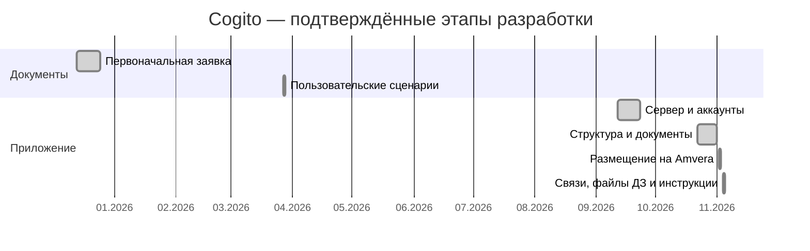

# Финальная заявка: Cogito

Автор: Мария Сагалаева. Обновлено: 4 ноября 2026 года.  
[Сайт](https://cogito-light-hearts-marussa.msk1.amvera.tech/) · [Код](https://github.com/marus-sa/Cogito) · [Сценарии](final_msagalaeva_userscripts.md) · [Старая заявка](OLD/msagalaeva_application.md)

## Продукт и проблема

Cogito — веб-приложение для бесплатных занятий Light Hearts. Расписание, домашние задания, переписка и проверка волонтёрских часов собраны в одном кабинете вместо отдельных чатов, форм и таблиц. Видеовстречи и записи остаются во внешних сервисах: Cogito хранит ссылки.

Потенциальный заказчик — Light Hearts. Подтверждённое техническое задание, интервью и пилот с участниками пока не оформлены. Планируется собрать обратную связь, не выдавая технические проверки за исследование пользователей.

## Пользователи

Ученики 5–11-х классов, их родители, репетиторы-волонтёры, наставники и администраторы. Родитель видит данные связанного ребёнка, наставник — отчёты закреплённых репетиторов.

## Функциональные требования

| № | Что делает пользователь | Сценарий |
| --- | --- | --- |
| 1 | Регистрируется, подтверждает почту, входит, редактирует профиль и выходит | 1 |
| 2 | Администратор одобряет или отклоняет заявку репетитора | 1 |
| 3 | Создаёт, переносит и отменяет занятия со ссылкой на видеовстречу | 6 |
| 4 | Назначает домашнюю работу, сдаёт ответ файлами или ссылкой, проверяет с оценкой и комментарием | 5 |
| 5 | Переписывается с доступными участниками в личных текстовых чатах | 2 |
| 6 | Просматривает результаты по сохранённым оценкам, заданиям и занятиям | 3 и 7 |
| 7 | Отправляет отчёт о занятии с длительностью и ссылкой на запись | 4 |
| 8 | Проверяет отчёт и учитывает подтверждённые часы | 8 |
| 9 | Администратор назначает роли, блокирует аккаунты и связывает участников | 9 |
| 10 | Просматривает уведомления и отмечает их прочитанными | 10 |

Все перечисленные данные сохраняются на сервере и загружаются после повторного входа, в том числе с другого устройства. Роль и связи проверяются сервером. Блокировка и смена роли закрывают все сессии участника; обычный выход — только текущую.

## Инструменты и база данных

- Интерфейс: JavaScript, Vue 3, Pinia, Vue Router, HTML/CSS, Vite. Компоненты помогают повторно использовать формы и кнопки.
- Сервер: Python, Flask, Gunicorn. Обработчики — обычные функции с SQL-запросами.
- Рабочий сайт: Amvera, Москва, Docker, один экземпляр приложения.
- Рабочая база: SQLite в постоянной папке Data, подключённой к `/app/server/data`. Аккаунты, сообщения, задания, файлы ответов и отчёты не зависят от конкретного устройства.
- Письма подтверждения: Gmail через SMTP. Секрет отправителя задаётся только на хостинге.
- GitHub хранит код; GitHub Actions проверяет приложение и собирает Docker. Amvera обновляет сайт по GitHub-вебхуку, отдельно от результата тестов.

SQLite выбрана для небольшого проекта с одним сервером: её проще запускать и сохранять. Код также поддерживает PostgreSQL через `DATABASE_URL`, а Docker Compose использует PostgreSQL; это альтернативный запуск, не текущая база Amvera. Пароли хранятся как хеши, секреты и настоящая база не публикуются.

## Устройства и браузеры

Для использования нужны интернет, JavaScript и cookie. Поддержка заявляется для Android 10+, iOS/iPadOS 16.4+, Windows 10+ и macOS 13+. Браузеры: Chrome/Edge 111+, Firefox 114+, Safari 16.4+. Нижняя граница браузеров соответствует настройкам сборки Vite; желательно использовать актуальный браузер.

Интерфейс рассчитан на ширину от 360 пикселей; широкие таблицы прокручиваются внутри блока. Предварительный ориентир для клиентского устройства — 2 ГБ оперативной памяти. Аппаратный минимум и все перечисленные сочетания ОС и браузеров экспериментально не проверены; это требования для дальнейшей приёмки, а не результаты испытаний. Видеосвязь и облачные диски могут предъявлять дополнительные требования.

Рабочий сервер использует 0,25 ядра и 512 МБ памяти. Точная вместимость по одновременным пользователям не установлена.

## Основные файлы

- `server/app.py` — запуск; `accounts.py` — регистрация, письма и профиль; `admin.py` — заявки и участники.
- `server/study.py` — занятия, задания и часы; `chat.py` — переписка; `common.py` — права и сессии.
- `server/database.py` — таблицы и база; `demo.py` — выключенные по умолчанию тестовые данные.
- `src/main.js`, `router.js`, `Layout.vue` — запуск, страницы и общее меню.
- `src/views/`, `components/`, `styles/` — экраны, общие элементы и оформление.
- `src/stores/`, `api.js`, `config.js`, `helpers.js` — данные, запросы, роли и небольшие расчёты.
- `package.json`, `package-lock.json`, `server/requirements.txt` — зависимости; `.env.example` — образец настроек.
- `tests/`, `server/test_*.py`, `.github/workflows/check.yml` — проверки.
- `Dockerfile`, `docker-compose.yml`, `amvera.yaml` — запуск и рабочий хостинг; `render.yaml` оставлен для альтернативного размещения.
- `README.md` — запуск; `final_msagalaeva_userscripts.md` — сценарии; `OLD/` — предыдущие документы.

## Аналоги

Для сравнения выбраны Google Classroom, Meleto и облачные диски. Особенность Cogito — учебные действия и проверка волонтёрских часов в одном процессе. Полное сравнение актуальных возможностей аналогов ещё не проведено.

## Этапы разработки

Ниже — укрупнённые этапы по изменениям в Git, а не учёт ежедневно потраченного времени.

Основание: [заявка](https://github.com/marus-sa/Cogito/commit/24585a2f66231cdfa108f47ab9d232a4698ac405), [сценарии](https://github.com/marus-sa/Cogito/commit/199c4e282a273fcb99d9a4d34262252d45435750), [сервер](https://github.com/marus-sa/Cogito/commit/844ac5837fbe3d827b71861425ad114436542895), [Amvera](https://github.com/marus-sa/Cogito/commit/206143c17339fbc05342310ac68b09c3227d3c39), [файлы домашних работ](https://github.com/marus-sa/Cogito/commit/2fb4e0ec55b7c62dc4f873837c2b3de49ba4477a). Даты сдачи в 2359 и показов кода здесь не подтверждаются.

Следующие этапы: пилот с участниками, исправление найденных ошибок, итоговый отчёт с рефлексией, новое видео по всем сценариям, презентация и репетиция защиты. Сроки не зафиксированы.

## Что проверено и что ещё не завершено

Сайт опубликован на Amvera. Пользователь подтвердил открытие страницы на телефоне без VPN, доставку письма, подтверждение почты и вход. Автоматические проверки охватывают пять ролей, независимые сессии, связи участников и доступ к файлам. Полный протокол пользовательской приёмки и нагрузочный тест ещё не проведены.

Для интерфейса проверены 47 сочетаний роли и раздела при ширине 360, 768 и 1280 пикселей, а также основные окна заданий, занятий и отчётов. Исправлены обрезание чата и растягивание главной страницы ученика. Это браузерная эмуляция на отдельной тестовой базе, а не проверка всех устройств и браузеров.

Нужно отдельно проверить восстановление резервной копии Data, следить за балансом Amvera и согласовать работу с персональными данными перед пилотом. Бесплатная пробная база Render больше не используется.

Нет собственной видеосвязи, хранения видео, групповых чатов, вложений в чаты, экспорта статистики, обычного восстановления пароля, полного удаления аккаунтов и учебных записей, редактирования отправленного отчёта о часах. Эти функции не выдаются за реализованные.

Файлы заявки и сценариев не заменяют итоговый отчёт, видео и презентацию. Содержание и статус сдачи в 2359 нужно сверять отдельно.
